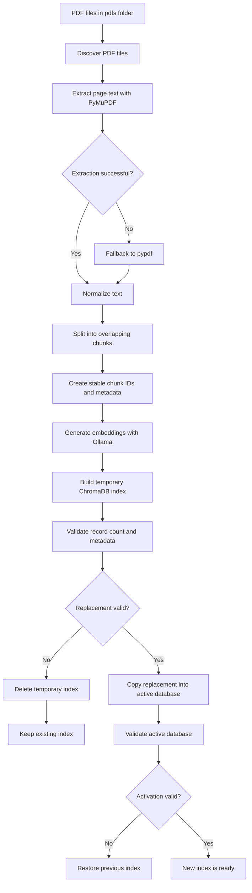
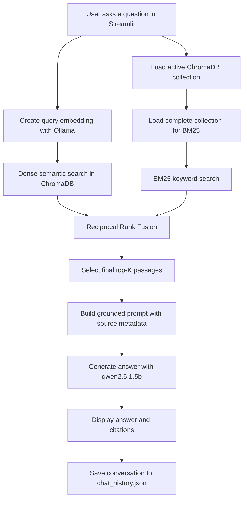
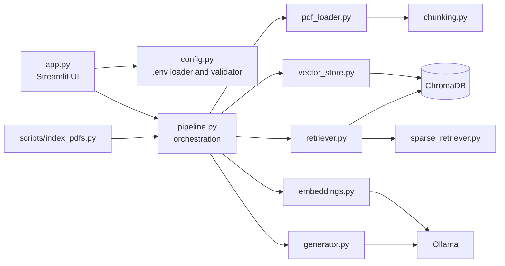

# Local PDF RAG Chatbot

A private, local chatbot for asking questions about PDF documents. The
application runs on Windows, uses Ollama for local AI inference, stores its
index in ChromaDB, and provides a Streamlit browser interface.

No OpenAI key, Gemini key, paid API, or cloud document storage is required.

## What the system does

The application:

- Accepts PDF files from the `pdfs\` folder or the browser upload control.
- Extracts text page by page.
- Splits text into overlapping chunks.
- Creates local embeddings with `nomic-embed-text`.
- Stores embeddings and source metadata in ChromaDB.
- Searches with both semantic retrieval and BM25 keyword retrieval.
- Combines results with Reciprocal Rank Fusion (RRF).
- Generates a grounded answer with `qwen2.5:1.5b`.
- Displays source filenames and page numbers with the answer.
- Keeps chat history locally in `chat_history.json`.

## Requirements

Install the following software before running the application:

- Windows
- Python 3.14 or newer
- [uv](https://docs.astral.sh/uv/)
- [Ollama](https://ollama.com/)
- Ollama model `nomic-embed-text`
- Ollama model `qwen2.5:1.5b`

Ollama must be available at:

```text
http://localhost:11434
```

## Installation

Open PowerShell in the project root:

```powershell
uv sync
```

Download the local models:

```powershell
ollama pull nomic-embed-text
ollama pull qwen2.5:1.5b
```

Create the local environment file:

```powershell
Copy-Item .env.example .env
```

The active application reads all runtime values from `.env` through
`src\chatbot\config.py`. Do not commit `.env`; it is intentionally ignored
by Git.

Important settings include:

```env
PDF_DIR=pdfs
CHROMA_DB_DIR=chroma_db
COLLECTION_NAME=pdf_documents
OLLAMA_HOST=http://localhost:11434
EMBEDDING_MODEL=nomic-embed-text
LLM_MODEL=qwen2.5:1.5b
CHUNK_SIZE=1000
CHUNK_OVERLAP=250
EMBED_BATCH_SIZE=32
UPSERT_BATCH_SIZE=128
DENSE_CANDIDATES=10
BM25_CANDIDATES=10
FINAL_TOP_K=3
RRF_K=60
LLM_TEMPERATURE=0.2
LLM_MAX_TOKENS=1000
MAX_CONTEXT_CHARS=12000
```

All of these settings are required. If a value is missing or invalid, the
application stops with a configuration error instead of silently using a
different hardcoded value.

## Run the application

### First run or after PDF changes

Place PDFs in:

```text
pdfs\
```

Or upload a PDF through the Streamlit sidebar. Uploaded files are saved
directly to the configured `PDF_DIR`.

Build or refresh the index:

```powershell
uv run python scripts\index_pdfs.py
```

Run indexing whenever you:

- Add a PDF.
- Replace or edit a PDF.
- Remove a PDF.
- Change chunking or embedding settings.

### Start the browser chatbot

```powershell
uv run streamlit run app.py
```

The browser application uses the existing ChromaDB index. You do not need to
run another search script.

## System pipeline

The following diagrams show the actual application flow.

### Indexing flow



The indexer uses a temporary database and rollback behavior. A failed
extraction, embedding request, validation step, or activation does not replace
the last working index.

### Question-answering flow



PDF content is treated as untrusted evidence. Instructions found inside a PDF
cannot override the chatbot's system behavior. If the retrieved evidence is
insufficient, the answer should state that the documents do not contain enough
information.

### Application architecture



## Features

### Local privacy

- Local Ollama inference.
- Local PDF files.
- Local ChromaDB vector storage.
- Local chat history.
- No paid cloud AI dependency.

### PDF ingestion

- Multiple PDF support.
- Page-by-page extraction.
- PyMuPDF as the primary extractor.
- pypdf fallback for unreadable files.
- Warnings for empty pages and scanned PDFs.
- Configurable chunk size and overlap.
- Stable chunk identifiers.
- Filename, page, and document metadata.
- Batch embedding generation.
- Safe index replacement and rollback.

### Hybrid retrieval

- Dense semantic search through ChromaDB.
- BM25 keyword search across the complete collection.
- RRF result fusion.
- Configurable candidate counts.
- Configurable final result count.
- Source metadata preserved for citations.

### Streamlit interface

- Browser-based chat.
- PDF upload from the sidebar.
- Uploads saved directly to `pdfs\`.
- Manual indexing button.
- Multiple local chat sessions.
- Persistent chat history.
- Expandable source passages.
- Source filename and page display.
- Indexed passage count.
- Clear indexing and Ollama error messages.

## Project structure

```text
AI-summit/
├── app.py                         # Streamlit browser application
├── scripts/
│   └── index_pdfs.py              # PDF indexing command
├── src/chatbot/
│   ├── config.py                  # .env loading and validation
│   ├── pdf_loader.py              # PDF extraction
│   ├── chunking.py                # Normalization and chunking
│   ├── embeddings.py              # Ollama embeddings
│   ├── vector_store.py            # ChromaDB lifecycle and rollback
│   ├── sparse_retriever.py        # BM25 retrieval
│   ├── retriever.py               # Dense retrieval and RRF
│   ├── generator.py               # Grounded answer generation
│   └── pipeline.py                # Workflow orchestration
├── pdfs/                          # Local PDF input directory
├── chroma_db/                     # Local generated vector database
├── .env.example                   # Safe configuration template
├── pyproject.toml                 # Project dependencies
└── uv.lock                        # Locked uv dependency versions
```

## Verification commands

Run linting:

```powershell
uv run ruff check .
```

Run Python syntax validation:

```powershell
uv run python -m compileall app.py scripts src
```

Run the complete workflow:

```powershell
uv run python scripts\index_pdfs.py
uv run streamlit run app.py
```

## Data and limitations

| Data | Location | Git status |
|---|---|---|
| PDF input files | `pdfs\` | Ignored |
| Vector index | `chroma_db\` | Ignored |
| Chat history | `chat_history.json` | Ignored |
| Private configuration | `.env` | Ignored |

Scanned PDFs containing only images require OCR. PyMuPDF and pypdf can extract
embedded text, but they cannot reliably recover text from image-only pages.
The small local language model may produce weaker answers for complex
questions. Larger PDF collections require more memory and longer indexing
times.

To reset only the generated vector index, stop Streamlit first and run:

```powershell
Remove-Item .\chroma_db -Recurse -Force
```

Keep the PDFs if you want to rebuild the index.
